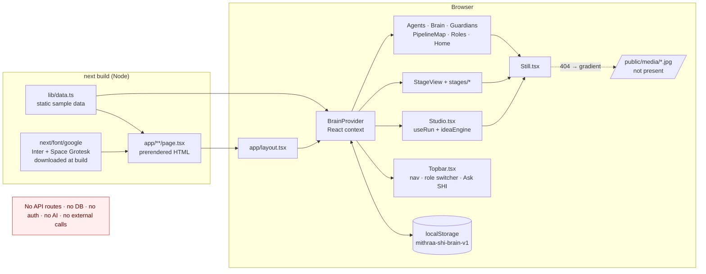

# Architecture

## Summary

Everything runs in one Next.js app. The server only prerenders HTML. All interaction
happens in the browser against an in-memory copy of `lib/data.ts`, saved to
`localStorage` under the key `mithraa-shi-brain-v1`.

## Request lifecycle

1. `next start` serves prerendered HTML for `/`, `/desk`, `/agents`, `/pipeline`,
   `/guardians`, `/brain`, `/roles` (static) and `/stages/[stage]` (9 paths from
   `generateStaticParams()` in `app/stages/[stage]/page.tsx`; unknown ids call `notFound()`). The
   page exports `ensureStatic = "navigation"` so an unknown id is rendered in full before any
   bytes are sent and gets a real HTTP 404. Without it, Partial Prefetching served the route's
   fallback shell (HTTP 200) first, and `notFound()` could only add `noindex`.
2. The browser hydrates. `BrainProvider` (`components/brain/BrainProvider.tsx`) builds
   `initialState()` from `STAGES`, `NOTES` and `AUDIT_SEED`, then merges any saved state
   from `localStorage` (shallow spread, no validation).
3. Every user action goes through the context API (`toggleCheck`, `passGate`, `decide`,
   `decideFeed`, `resolveFlag`, `setNote`, `log`, `setRole`, `reset`). Each appends an
   entry to `audit` (capped at 60) and the state is written back to `localStorage`.

## Key business rules (as modelled)

| Rule | Where |
| --- | --- |
| Only roles in `stage.gate.approvers` can tick or sign a gate | `canSign`, `toggleCheck`, `passGate` in `BrainProvider.tsx` |
| Gate signs only if every item is checked | `passGate` |
| Stages unlock in order; the first unpassed stage is "active" | `activeStage` / `stageState` |
| Each role sees only its stages | `Role.stages` in `lib/data.ts`, used by UI |
| AI output is labelled "AI-made" until accepted | `AiTag` in `components/ui.tsx` |

These rules are enforced **only in client JavaScript** for a demo. Any user can switch to
the Producer role from the sidebar. They are not access control.

## Simulated "agents"

- `useRun(steps)` (`components/studio/useRun.ts`): a 50 ms interval clock that reports 0..1
  progress per step; 5× faster under `prefers-reduced-motion`.
- `runIdeaAgents(spark)` (`components/studio/ideaEngine.ts`): FNV-style hash of the text plus
  regex tables picks a scene, genre, title and pseudo-random scores. Same input → same output.
- `AskShi` (`components/shell/Topbar.tsx`): matches keywords like "gate", "budget", "flag",
  "approval", "cast" against canned answers and route names.

## Rendering configuration (`next.config.ts`)

- `cacheComponents: true` and `partialPrefetching: true` (Next 16 features).
- Turbopack rule runs `@tailwindcss/turbopack` on every `*.css`.
- `poweredByHeader: false` and a `headers()` block (nosniff, Referrer-Policy, X-Frame-Options).
- No `images`, `rewrites`, `env` or `output` settings.

## Modules not present

Backend/API, database/ORM/migrations, authentication, background jobs, file uploads,
payments, email/SMS, AI providers, analytics, Docker: **none exist**. CI is a GitHub Actions
workflow; hosting is Vercel's standard Next.js integration.
