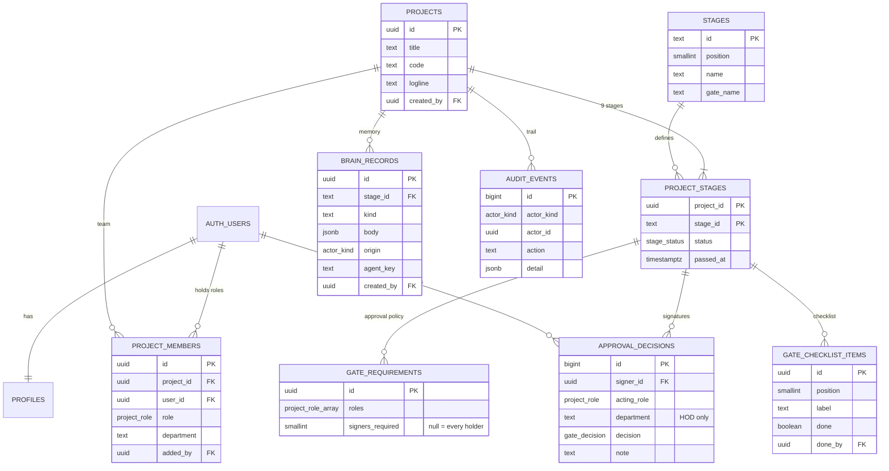

# Project Brain — Database Architecture (Phase 1A)

*Migrations: [`20261024183806_project_brain_foundation.sql`](../supabase/migrations/20261024183806_project_brain_foundation.sql),
[`20261025010000_hod_department_approvals.sql`](../supabase/migrations/20261025010000_hod_department_approvals.sql) (Phase 1A.1, see [HOD_DEPARTMENT_APPROVALS.md](HOD_DEPARTMENT_APPROVALS.md)) ·
Tests: [`supabase/tests/`](../supabase/tests/) ·
Postgres 17 (Supabase local stack).*

This is the first real storage for the Project Brain: one shared, permissioned record per film.
The requirements come from the blueprint as captured in the owner's business-flow and application-flow
notes (`BUSSINESS_FLOW.md`, `APPLICATION_FLOW.md`). Those notes are not part of this PR; they land in a
separate docs PR. Phase 1A covers **identity, project isolation, stages,
multi-signer gates and audit**. It does not cover agents, guardians, vectors or a knowledge graph.

## 1. Entity relationship model

| Table | Purpose | Client can write |
| --- | --- | --- |
| `stages` | The nine stages (reference data) | — |
| `profiles` | Display name per auth user, created by a sign-up trigger | `display_name` (own row) |
| `projects` | One film | `title`, `code`, `logline` (producers). Created only through `create_project()` |
| `project_members` | Project-scoped roles (`RoleId` from `lib/data.ts`). A person can hold several roles; `department` separates HODs and is required on HOD rows | insert/delete (producers only) |
| `project_stages` | `locked` → `active` → `passed` per project; one active stage at most (partial unique index) | — (triggers only) |
| `gate_requirements` | Configurable approval policy per gate | — |
| `gate_checklist_items` | Gate checklist; tick attributed by trigger | `done` (gate roles, active stage) |
| `approval_decisions` | Individual signatures, append-only. HOD signatures name their department | `project_id, stage_id, acting_role, department, decision, note` |
| `brain_records` | Project memory items (Idea Card, Story Bible, note…) with provenance | `project_id, stage_id, kind, title, body` |
| `audit_events` | Append-only, trigger-written trail | — |
| `private.default_gate_*` | Templates copied into each new project | — (not exposed) |

### Approval policy

A gate passes when **every** `gate_requirements` row for it is met **and** every checklist item is done:

- `signers_required = n`: at least *n* distinct people approve, each acting in one of `roles`.
- `signers_required = null`: **every** current member holding one of `roles` approves. At least one
  such member must exist, so an empty HOD list never passes Gate 6 by default.

Only the latest decision per (signer, role, department) counts, and only while the signer still holds
that role (and, for a HOD, that department). Repeating your latest decision in the same role and
department is rejected as a duplicate (`23505`); changing it (reject → approve) is a new row.

**HOD departments.** A HOD decision must name a department (`23514` if missing) that matches one of
the signer's own HOD memberships on that project (`42501` otherwise). Other roles cannot name one
(`23514`); their membership `department` stays free-form metadata and plays no part in approvals.
"Every HOD" means every (HOD, department) membership, so a person who is HOD of Camera and Sound
signs twice. Numeric rules such as "two HODs" still count distinct people, not departments.

#### Operating models: solo filmmaker and team

Approvals are evaluated against **roles**, not against separate accounts. One person can run the
whole film:

- The producer (the project creator) can add themselves in any other role, e.g. writer, director,
  investor, HOD, client. Non-producers cannot add or change roles, including their own.
- Each requirement row is evaluated independently. One person holding producer, director and HOD
  meets all three Gate 6 rows with three signatures, one per acting role. Each signature is its own
  `approval_decisions` row and audit event with the real `signer_id`, `acting_role`, `department`
  (HOD only) and timestamp. A person who is HOD of several departments signs once per department.
- No default row demands distinct people. All defaults are `1` or "every holder", and a solo
  owner is the only holder. A distinct-person rule exists only when a project sets
  `signers_required > 1`, and it applies within that row only (e.g. "two different directors").
  Nothing requires that the producer and director be different people.
- A team splits the same roles across members. A member can still hold several roles when the
  producer grants them.

Gates 5 and 8 need an investor and a client/buyer member. Today a solo owner can add themselves in
those roles, but that records investor or buyer acceptance that did not happen. Self-financed and
self-distributed projects need their own path (§4a, R2).
Both scenarios are tested end to end in `supabase/tests/gate_operating_models.test.sql`. The solo
case runs all nine gates without fast-forwarding. Department sign-offs for both models are tested in
`supabase/tests/hod_department_approvals.test.sql`.
The final approving signature passes the gate and opens the next stage in the same transaction.
A row lock on the stage serialises concurrent signatures, and membership changes take the same lock,
so a signature always evaluates "every holder" against a committed roster.

Default policy copied by `create_project()` (from the blueprint gate rules):

| Gate | Requirements |
| --- | --- |
| 1 Idea Greenlight | 1 of {producer, writer} ("creator or producer") |
| 2 Story Approval | writer + director + producer |
| 3 Script Lock | director + producer |
| 4 Protection Complete | writer + producer. The producer comes from the prototype; the blueprint says "all credit parties sign" (open question 3) |
| 5 Financing Close | producer + **every** investor |
| 6 Shoot Ready | producer + director + **every** HOD, once per department |
| 7 Picture Wrap | director |
| 8 Final Delivery | director + client/buyer |
| 9 Release | producer |

## 2. Security boundaries

| Requirement | How it is enforced | Test |
| --- | --- | --- |
| Unauthenticated users read nothing | `anon` has no grants on any table or on `create_project` | pgTAP 2–3, e2e 1–2 |
| Members cannot see other projects | Every policy is `private.is_member(project_id)` | pgTAP 10–12, 16–17, e2e 5 |
| No self-assigned roles | Only producers insert members; `added_by` must equal `auth.uid()`; the first producer comes from `create_project()` | pgTAP 9, 13, 18, e2e 6 |
| Decisions are attributable | `signer_id` has no client grant and is overwritten with `auth.uid()` by a trigger | pgTAP 19, 27, 44, e2e 7 |
| Agents cannot approve | Decision triggers reject any insert without `auth.uid()`. Triggers run even for `service_role`, which bypasses RLS | pgTAP 38 |
| Signers need the role | RLS and the trigger both check that the signer holds `acting_role` and that the role appears in the gate policy | pgTAP 29, 39 |
| HODs sign only their own departments | `before_decision` requires a matching HOD membership on the same project; a check constraint keeps `department` HOD-only | `hod_department_approvals` 2–6, 23–26 |
| Audit cannot be forged or edited | No client grants; `forbid_change` trigger blocks UPDATE/DELETE for every role; TRUNCATE revoked from `service_role` | pgTAP 21–22, 35–37, e2e 9 |
| Agent drafts stay labelled | Clients cannot set `origin`/`agent_key`; agent rows need `agent_key` | pgTAP 24 |
| Privileged keys stay off the browser | App uses only `NEXT_PUBLIC_SUPABASE_PUBLISHABLE_KEY`; no code reads secret keys | bundle scan |

Implementation notes:

- RLS helpers (`private.is_member`, `has_role`, `shares_project`, `can_act_on_gate`, `gate_satisfied`)
  are `SECURITY DEFINER` with `search_path = ''`, in the unexposed `private` schema, so they are not
  RPC endpoints. `public.create_project` is the one exposed definer function. It checks `auth.uid()`
  and rejects anonymous sessions.
- User metadata is used only for `display_name`, never for authorization.
- `audit_events.actor_id` has no foreign key, so history survives user deletion. `approval_decisions.signer_id`
  keeps one, so a user who has signed cannot be hard-deleted (see open question 9).

## 3. Deliberately deferred

| Entity | Why not now |
| --- | --- |
| Agent definitions, agent runs, spend metering | No agent runtime exists. `brain_records.origin/agent_key` reserves provenance |
| Guardian flags | Need agents or rules that raise them. Next PR candidate |
| Non-gate sign-offs (`APPROVALS`), script notes, feed | Screen-specific. Arrive with the screen migration |
| Acceptance of AI drafts | Needs agent writes first |
| Per-stage visibility inside a project (`Role.stages`) | The prototype hides stages per role. Phase 1A isolates projects, not stages |
| Organisations/studios, invitations | Product decision pending (blueprint §16 Q1–2) |
| Vector index, knowledge graph | The blueprint says plain PostgreSQL first |
| Gate reopen / revision flow | Not specified by the blueprint |

## 4. Open approval-policy questions

1. **Defaults vs contract.** The default policy above is read from gate rule text. Confirm it per gate.
2. **Who edits the policy?** `gate_requirements` is read-only to clients. Should a producer change it, and should a change during an open gate reset existing signatures?
3. **Gate 4 "all credit parties".** Credit parties are not a role. Model them as a role, a department, or a per-gate list of named people?
4. **Resolved: one person, several roles.** Allowed by product decision (solo filmmaker). See *Operating models* above. HOD sign-offs are per department since Phase 1A.1 (§4a, R1).
5. **Rejections.** A reject is recorded but does not block other signers. For "1 of {producer, writer}" a writer's reject is overridden by a producer approve. Should a reject veto?
6. **Checklist changes after signing.** Unticking an item blocks the pass, but earlier approvals stay valid. Should they be invalidated?
7. **"Every HOD" snapshot.** "Every" is evaluated live, so adding a HOD mid-gate adds a required signature. Should the signer list freeze when the gate opens?
8. **Order, delegation, expiry.** Sequential signing, delegates and signature expiry are not modelled (blueprint §9 leaves them open).
9. **User deletion.** Signers cannot be hard-deleted. Decide the retention and anonymisation policy.

## 4a. Required before any screen writes decisions

Owner requirements, built as additive follow-up migrations. Neither changes the Phase 1A migration.
No migration has been applied to a persistent database, and no screen writes decisions yet.

**R1. HOD approvals identify the department. Implemented** (Phase 1A.1,
`20261025010000_hod_department_approvals.sql`, details in [HOD_DEPARTMENT_APPROVALS.md](HOD_DEPARTMENT_APPROVALS.md)).
One person may be HOD of several departments and signs for each one separately. One change from
the original plan: `gate_satisfied` compares departments for HOD rows only, not
`m.department is not distinct from a.department`. Otherwise a non-HOD member with department
metadata could never meet an "every holder" row.

**R2. Pending.** Solo projects can be self-financed and self-distributed without recording investor or buyer
acceptance that did not happen.

- A per-project declaration set by the producer and written to the audit log: financing
  `external | self` and distribution `external | self`, both defaulting to `external`.
- When `self`, the Gate 5 investor row and the Gate 8 client row are replaced by a producer row.
  Third-party checklist items ("Investor agreements signed", "Deliverables accepted by buyer") are
  replaced by producer attestations.
- Product decisions needed first: the attestation wording; whether the declaration can change once
  Gate 5 or Gate 8 is open (proposal: no, it locks when the gate opens); whether a project can later
  switch to an external investor or buyer, and whether that reopens the gate.

Out of scope for both: policy editing by producers (question 2), organisations, and any UI.

## 5. Migration structure and workflow

One imperative migration (the project has no `supabase/schemas/`). In order: schemas and enums →
reference data and templates → tables → RLS helpers → triggers → `create_project` → policies → grants.
Change it with `supabase migration new <name>`, test with `npm run db:test`, regenerate types with
`npm run db:types`.
